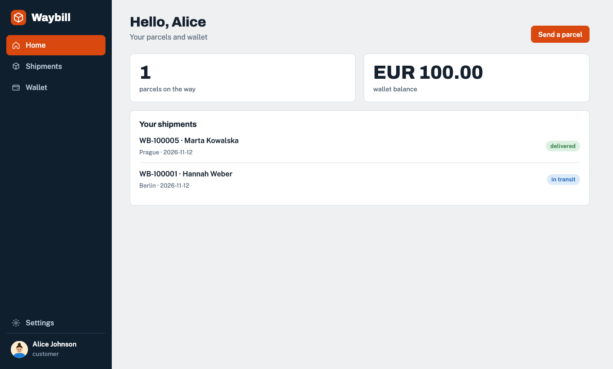
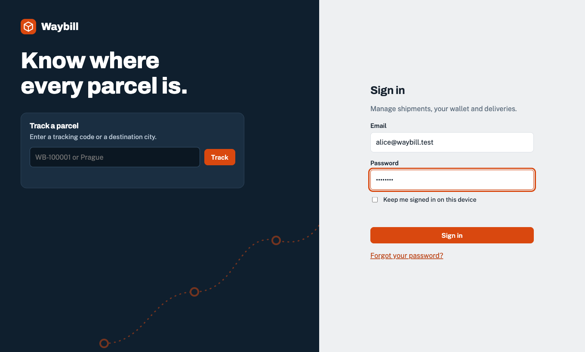

<p align="center">
  
</p>

<p align="center"><b>Parcel tracking and shipping, built with plain Java Servlets.</b></p>

<p align="center">
  
</p>

Waybill lets customers get a price quote, send parcels, follow them by tracking code, and pay from a wallet balance. Couriers and admins have their own tools for depots and shipment management.

## Features

- Track a parcel by tracking code or destination city (no login needed)
- Instant price quotes by weight and service (economy, standard, express)
- Create and manage shipments, with delivery instructions and an event timeline
- Wallet balance and payments
- Profile with avatar upload
- Roles: customer, courier, admin
- Depot tools for staff (exports, imports)
- Carrier webhook endpoint for status updates

## Tech stack

| Layer | Technology |
|-------|------------|
| Backend | Java 21, Jakarta Servlet 6 (no framework), HikariCP, Jackson |
| Server | Apache Tomcat 10.1 |
| Database | PostgreSQL 16 |
| Frontend | Static HTML, CSS and vanilla JavaScript (`src/main/webapp`) |
| Build | Gradle (wrapper included), packaged as `ROOT.war` |
| Runtime | Docker Compose |

## Quick start (Docker Compose)

Requirements: Docker with the Compose plugin (Docker Desktop, or Colima plus `docker-compose`). Nothing else is needed. Java and Gradle run inside the build container.

```bash
git clone https://github.com/kan0n1r/waybill.git
cd waybill
cp .env.example .env        # optional: change the port or database credentials
docker compose up --build -d
```

The first build downloads dependencies and takes a few minutes. When it finishes, open **http://localhost:8080**.

On first start the app creates the database schema and seeds demo data.

### Demo accounts

| Role | Email | Password |
|------|-------|----------|
| Customer | `alice@waybill.test` | `alice123` |
| Customer | `bob@waybill.test` | `bob12345` |
| Courier | `courier@waybill.test` | `Courier#2024` |
| Admin | `admin@waybill.test` | `Admin#2024` |

Try tracking `WB-100001` or the city `Prague` on the login page without signing in.

### Everyday commands

```bash
docker compose logs -f app      # follow application logs
docker compose ps               # check service status
docker compose down             # stop everything, keep the database
docker compose down -v          # stop and delete the database volume (full reset)
docker compose up --build -d    # rebuild after changing the code
```

## Configuration

Settings are read from `.env` (copy `.env.example`):

| Variable | Default | Description |
|----------|---------|-------------|
| `APP_PORT` | `8080` | Host port for the web app |
| `DB_USER` | `waybill` | PostgreSQL user |
| `DB_PASSWORD` | `waybill_dev_pw` | PostgreSQL password |

The app container also receives `DB_URL` (set to the `db` service) and `EXPORT_DIR` (`/var/waybill/exports`).

## Services

| Service | Image | Purpose |
|---------|-------|---------|
| `app` | built from `Dockerfile` | Tomcat with the Waybill WAR, published on `APP_PORT` |
| `db` | `postgres:16-alpine` | Data storage, with a healthcheck; data lives in the `dbdata` volume |
| `carrier-gateway` | `nginx:alpine` | Mock carrier API, reachable only from inside the Compose network |

## Running without Docker

Requirements: JDK 21, PostgreSQL 16, and a Tomcat 10.1 server.

```bash
createdb waybill
./gradlew war                                   # produces build/libs/ROOT.war
export DB_URL=jdbc:postgresql://localhost:5432/waybill
export DB_USER=waybill DB_PASSWORD=waybill
cp build/libs/ROOT.war $CATALINA_HOME/webapps/
$CATALINA_HOME/bin/catalina.sh run
```

## Project layout

```
src/main/java/com/waybill/
  servlets/        HTTP endpoints (auth, shipments, quote, track, wallet, depot, admin, webhook)
  web/             shared servlet base class, auth filter, JSON helpers
  AppInit.java     schema creation and demo data on startup
  Db.java          connection pool and query helpers
src/main/resources/schema.sql
src/main/webapp/   static frontend (index.html, app.html, app.js, style.css)
internal/          nginx config and files for the mock carrier gateway
Dockerfile         multi-stage build: Gradle, then Tomcat
docker-compose.yml
```

## Screenshots

| Sign in and public tracking | Customer dashboard |
|:---:|:---:|
|  |  |

## Troubleshooting

- **Port already in use:** set `APP_PORT` in `.env` to a free port and run `docker compose up -d` again.
- **Blank page or 404 right after start:** Tomcat needs a few seconds. Check `docker compose logs app`.
- **`docker: unknown command: docker compose`:** install the Compose plugin (`brew install docker-compose` on macOS) and make sure Docker can find it.
- **Start from scratch:** `docker compose down -v && docker compose up --build -d`.
